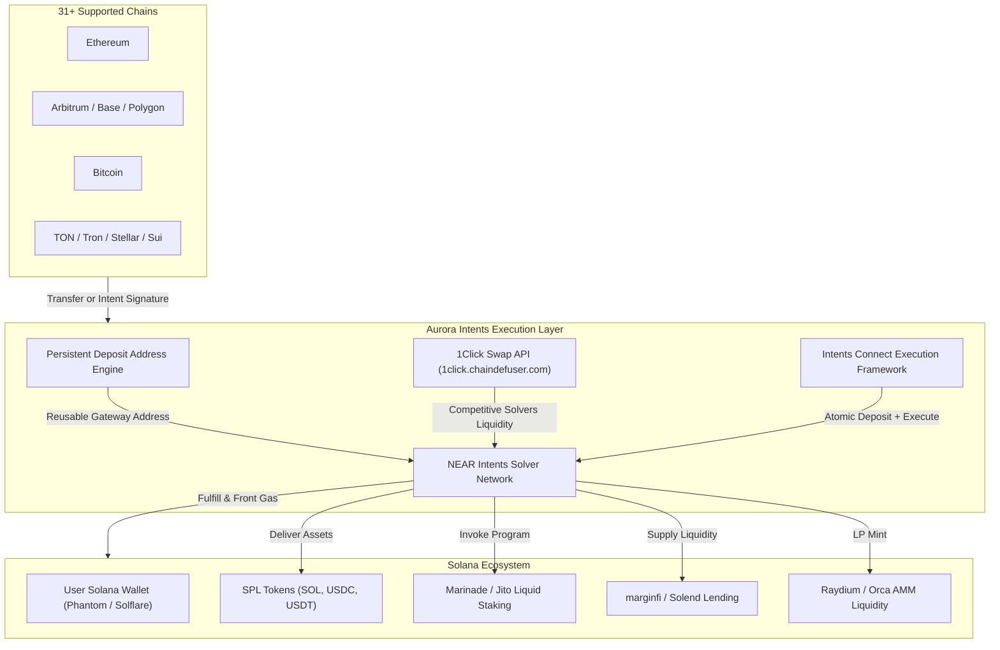

# 🌊 OmniFlow — Universal Cross-Chain DeFi Gateway on Solana

> **Solana Hackathon 2026 — Aurora Intents Challenge**  
> **Targeting 1st Place ($1,500 + Full Aurora Winner Support Bundle)**

---

## 🏆 Executive Summary

**OmniFlow** is a comprehensive, production-ready DeFi gateway on Solana that brings **any-chain liquidity to Solana** by integrating **all three Aurora Intents products**:
1. **Intents Swap API (1Click)** — Instant cross-chain swaps between 31+ chains and Solana SPL tokens.
2. **Intents Deposits** — Persistent, reusable deposit addresses (inspired by Solflare & COCA wallet architectures) allowing users on Bitcoin, EVM, Tron, TON, Stellar, etc. to fund Solana accounts with zero destination-gas friction.
3. **Intents Connect** — Deposit + execute in one single flow (contract-level composability to directly stake on Marinade/Jito, lend on marginfi/Solend, or provide liquidity on Raydium/Orca).

OmniFlow eliminates the "sweaty palm syndrome" of traditional bridges, gas tokens, and multi-network wallet switching, opening Solana's DeFi ecosystem to 31+ external blockchain userbases.

---

## 🎯 How OmniFlow Addresses Every Judging Criterion

| Judging Criterion | How OmniFlow Solves It | Technical Implementation |
|---|---|---|
| **Ships a working integration of at least one Aurora Intents product** | Integrates **all three** products: Swap API, Intents Deposits, and Intents Connect | `lib/aurora/swapApi.ts`<br/>`lib/aurora/deposits.ts`<br/>`lib/aurora/connect.ts` |
| **Removes a real cross-chain friction point** | Users holding assets on Bitcoin, Ethereum, Arbitrum, Base, TON, etc. can use Solana DeFi without manual bridging or holding SOL for gas | Persistent deposit addresses + single-signature intent routing |
| **Technical quality & settlement/refund handling** | Full lifecycle handling (`pending` → `detected` → `processing` → `completed` / `refunded`) with transparent state tracking and solver escrow verification | `app/dashboard/page.tsx`<br/>`lib/utils.ts` |
| **Clean UX** | Step-by-step intuitive wizards hiding cross-chain cryptographic and solver complexity | Glassmorphism UI with Tailwind CSS, animated status indicators, and Solana Wallet Adapter |
| **Fit & creativity (Trading / Consumer / Infra)** | Combines trading, payments, and automated DeFi actions into a "universal remote control" for Solana | Liquid staking, lending pools, and DEX routing in 1 click |
| **Bonus: Multi-chain source coverage** | 31+ supported blockchains including EVM, Bitcoin, TON, Tron, NEAR, Stellar, Sui | `lib/constants.ts` |
| **Bonus: Contract-level composability (Intents Connect)** | Direct post-arrival smart contract invocation on Solana (Marinade, Jito, marginfi, Solend, Raydium) | `app/defi/page.tsx` + `lib/aurora/connect.ts` |
| **Bonus: Confidential Intents use case** | Toggle for Confidential Intents mode preserving swap routing privacy | `app/swap/page.tsx` |
| **Custom Fees & Revenue Model** | 60% Integrator / 40% Aurora fee split implementation with live telemetry | `app/dashboard/page.tsx` |

---

## 🏗 System Architecture



---

## ⚡ Core Features

### 1. 🔄 Universal Swap (Swap API + Widget)
- Programmatic swap quotes via `@defuse-protocol/one-click-sdk-typescript` and 1Click REST API.
- Direct deposit address generation with slippage tolerance and deadline parameters.
- Optional **Confidential Intents** privacy toggle.
- Non-custodial refund mechanism if solver times out.

### 2. 💰 Omni-Deposit (Intents Deposits)
- Persistent deposit addresses mapped per user/wallet across 31+ blockchains.
- Modeled after the production case studies of **Solflare Wallet** and **COCA**.
- Users can deposit from centralized exchanges (Binance, Coinbase) or cold wallets straight into Solana without dApp connection.

### 3. ⚡ Cross-Chain DeFi Actions (Intents Connect)
- **Deposit + Stake**: Send assets from any chain and receive `mSOL` or `JitoSOL` on Solana.
- **Deposit + Lend**: Supply capital directly into marginfi or Solend lending pools.
- **Deposit + LP**: Provide liquidity to Raydium or Orca AMM pools in one step.
- Solver network handles bridge, swap, and contract invocation atomically.

### 4. 📊 Protocol & Telemetry Dashboard
- Real-time transaction history showing origin chain, settlement status, and Solscan verification.
- Integrator revenue split metrics displaying the 60/40 fee share model enabled by Aurora Widget Studio.

---

## 💻 Tech Stack

- **Framework**: Next.js 14 (App Router), React 18, TypeScript
- **Styling**: Tailwind CSS, Framer Motion, Lucide Icons
- **Solana Web3**: `@solana/web3.js`, `@solana/wallet-adapter-react`, `@solana/wallet-adapter-react-ui`
- **Aurora & NEAR Intents**:
  - `@defuse-protocol/one-click-sdk-typescript` (1Click Swap API)
  - `@aurora-is-near/intents-connect` (Intents Connect SDK)
  - `@aurora-is-near/intents-swap-widget`
- **Asset Identifiers**: NEP-141 OMFT identifiers (`nep141:sol-<mint>.omft.near`)

---

## 🚀 Quick Start Guide

### 1. Clone & Install Dependencies
```bash
git clone https://github.com/your-username/omniflow.git
cd omniflow
npm install
```

### 2. Configure Environment Variables
Copy `.env.example` to `.env.local`:
```bash
cp .env.example .env.local
```

Configure your Aurora Widget Studio API key and endpoints:
```env
NEXT_PUBLIC_AURORA_API_KEY=your_widget_studio_key
NEXT_PUBLIC_SOLANA_RPC_URL=https://api.mainnet-beta.solana.com
NEXT_PUBLIC_SOLANA_NETWORK=mainnet-beta
NEXT_PUBLIC_ONECLICK_API_BASE=https://1click.chaindefuser.com
NEXT_PUBLIC_FEE_BPS=50
```

### 3. Launch the Application
```bash
npm run dev
```
Open [http://localhost:3000](http://localhost:3000) in your browser.

---

## 📂 Project Structure

```
omniflow/
├── app/
│   ├── layout.tsx             # Root Layout with Solana Providers & Navbar
│   ├── page.tsx               # High-converting Landing Page with feature showcase
│   ├── globals.css            # Custom theme, glassmorphism, and wallet styling
│   ├── swap/
│   │   └── page.tsx           # Universal 1Click Swap & Widget interface
│   ├── deposit/
│   │   └── page.tsx           # Persistent Deposit Address generator & QR
│   ├── defi/
│   │   └── page.tsx           # Intents Connect cross-chain DeFi execution
│   └── dashboard/
│       └── page.tsx           # Settlement status, analytics, and revenue split
├── components/
│   ├── layout/
│   │   ├── Navbar.tsx         # Navigation header with Solana wallet connection
│   │   └── Footer.tsx         # Resource links, hackathon attribution
│   └── providers/
│       └── Providers.tsx      # Solana Connection & Wallet Adapter Provider
├── lib/
│   ├── aurora/
│   │   ├── swapApi.ts         # 1Click Swap API client & OMFT asset mapping
│   │   ├── deposits.ts        # Persistent deposit address generation & status
│   │   └── connect.ts         # Intents Connect cross-chain composability engine
│   ├── constants.ts           # 31+ supported chains, tokens, DeFi protocols
│   ├── types.ts               # Complete TypeScript definitions
│   └── utils.ts               # Formatting, explorer links, clipboard, status styles
├── tailwind.config.ts         # Aurora & Solana brand palette
├── next.config.js             # Webpack fallbacks for Web3 compatibility
└── package.json
```

---

## 🎖 Hackathon Submission Checklist

- [x] Working integration of Aurora Swap API (1Click)
- [x] Working integration of Aurora Intents Deposits (Persistent addresses)
- [x] Working integration of Aurora Intents Connect (Cross-chain DeFi execution)
- [x] Solflare-style permanent deposit address workflow
- [x] Multi-chain support (31+ chains: Bitcoin, EVM, TON, Tron, NEAR, Solana)
- [x] Contract-level composability on Solana (Marinade, Jito, marginfi, Raydium)
- [x] Confidential Intents privacy option
- [x] Correct settlement and refund lifecycle handling
- [x] Integrator fee configuration with 60/40 revenue share
- [x] Responsive, high-polish dark mode UI matching Aurora and Solana design languages

---

Built with pride for **Solana Hackathon 2026** — Powered by **Aurora Intents**.

